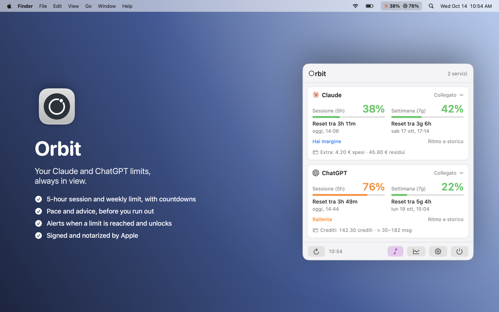
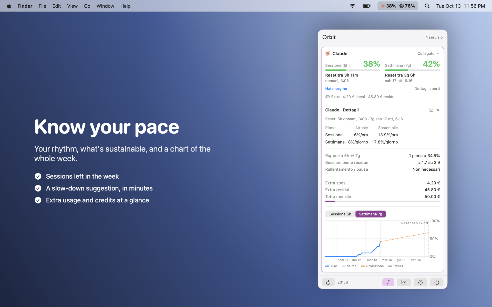
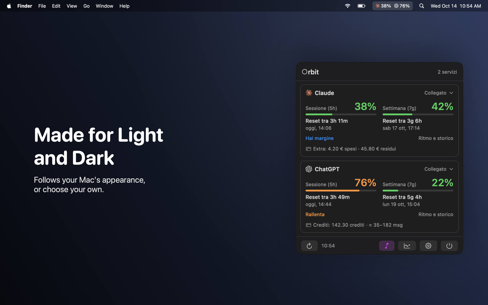
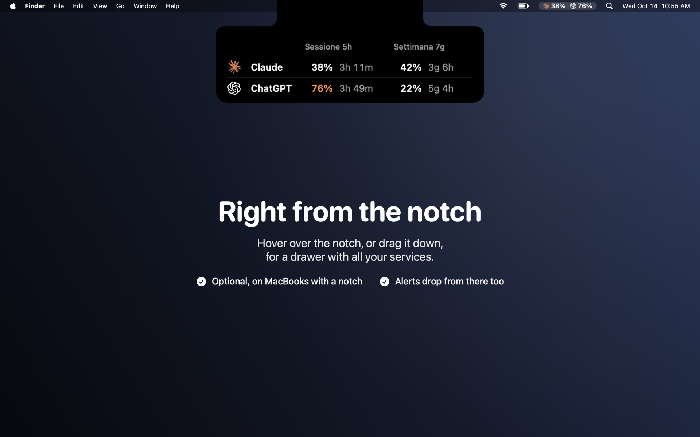
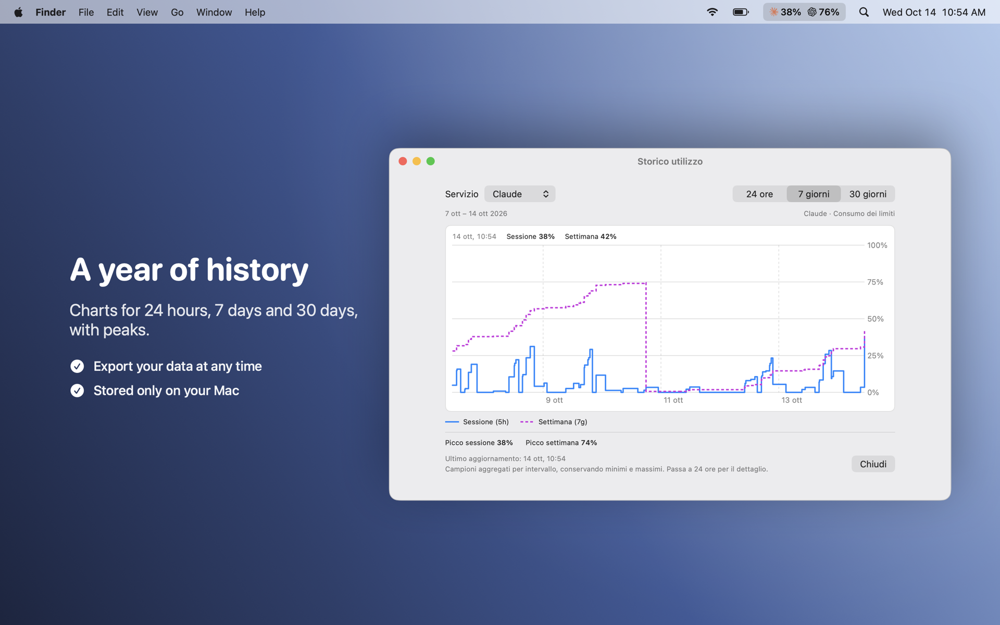
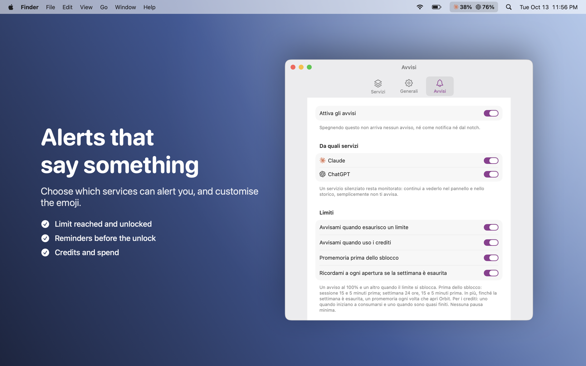
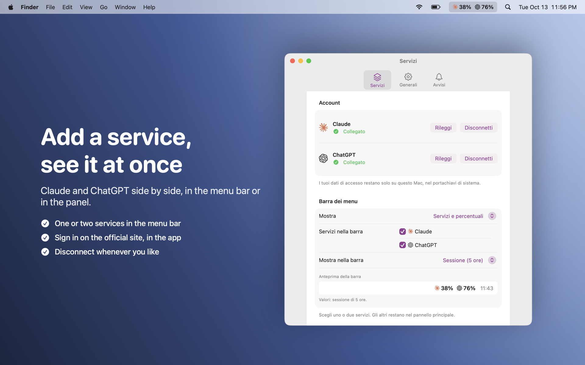

  

<h1 align="center">Orbit</h1>

  See how much of your Claude and ChatGPT usage limits you've used, and when they reset, from the menu bar.

  <a href="https://github.com/DevDreamer99/Orbit-Releases/releases/latest"><b>⬇︎ Download the latest version</b></a>
  &nbsp;·&nbsp; macOS 14 Sonoma or later &nbsp;·&nbsp; Apple silicon &amp; Intel

---

## Screenshots

  

<table>
  <tr>
    <td></td>
    <td></td>
  </tr>
  <tr>
    <td></td>
    <td></td>
  </tr>
  <tr>
    <td></td>
    <td></td>
  </tr>
</table>

The screenshots use sample data. The interface is in Italian.

## Install

1. Download the `.dmg` from the [latest release](https://github.com/DevDreamer99/Orbit-Releases/releases/latest).
2. Open it and drag **Orbit** into **Applications**.
3. Open Orbit: it lives in the menu bar. Open **Settings → Services** (in Italian: **Impostazioni → Servizi**), choose **Add service…** (**Aggiungi servizio…**) and sign in to Claude and/or ChatGPT with your own account.

Once a day Orbit asks GitHub whether a newer version exists and tells you if so. To update, press **Update** (**Aggiorna**) in the banner: Orbit downloads the new version, checks that it is signed by the developer, and opens it so you can drag Orbit into **Applications**. Nothing is downloaded until you press the button, and Orbit never installs anything by itself. You can turn the check off in **Settings → General** (**Impostazioni → Generali**).

If you have 1.1.0, install 1.2.0 by hand once from the [latest release](https://github.com/DevDreamer99/Orbit-Releases/releases/latest): from 1.2.0 on, updates are one click.

## Features

- **Both limits at a glance**: the 5-hour session and the weekly limit of each service, with percentages, bars and countdowns to the reset. Claude and ChatGPT side by side.
- **Pace and advice**: Orbit tells you when you're going too fast to reach the reset, and when you have room to use more.
- **Alerts that say something**: when a limit is reached and when it unlocks, with reminders shortly before; low-usage and credit alerts. Choose which services can alert you and customise the emoji.
- **Credits and spend**: Claude's extra usage (spent, left and monthly cap) and your ChatGPT credit balance, and, for Claude, a monthly total (the plan price you enter plus extra usage).
- **History**: charts for 24 hours, 7 days and 30 days, with peaks. Orbit keeps a year of history on your Mac and can export it.
- **Menu bar your way**: services with percentages, or just the logo. Up to two services at a time.
- **Notch drawer** *(optional, MacBooks with a notch)*: hover over the notch, or drag it down, to open a drawer with all your services. Alerts drop from there too.
- **Light and dark mode.** The interface is in Italian; English, Français, Deutsch and Español are partly translated.

## Safe by design

- **Signed with a Developer ID and notarized by Apple**: macOS checks every download.
- **Read-only.** Orbit only reads your usage. It never sends a message and never changes your conversations, settings or plan.
- **Your sign-in stays on your Mac.** You sign in to Claude or ChatGPT yourself, in a window inside the app. Credentials are kept in the macOS Keychain and are never sent anywhere else.
- **No analytics, no telemetry, no account with us.**
- **Few addresses, all explained.** Orbit itself only talks to `claude.ai` and `chatgpt.com` (to read your usage) and to GitHub: `api.github.com` for the daily update check (which you can turn off) and, only when you press **Update**, `github.com` and GitHub's file storage to download the new version. While you sign in, the service's own login page loads whatever it normally does, such as its sign-in provider, exactly as it would in any browser.
- **Easy to remove.** *Uninstall* in Settings erases your sign-ins, history and settings.

## Good to know

Orbit is an unofficial app. It reads the same web pages that the Claude and ChatGPT sites use, which are not documented and can change or stop working without notice. Using them may not be allowed by the terms of those services: it is your choice to use Orbit with your own accounts.

Orbit is not affiliated with, endorsed by or sponsored by Anthropic or OpenAI. "Claude" and "ChatGPT" and their logos belong to their owners.

## Requirements

| Version | macOS | Macs |
|---|---|---|
| 1.1.0 and later | 14 Sonoma or later | Apple silicon and Intel |

## What's new

**1.2.0**
- **Update inside the app.** Press **Update** in the banner: Orbit downloads the new version, checks its signature and opens it, ready to drag into Applications.

**1.1.0**
- First public release.
